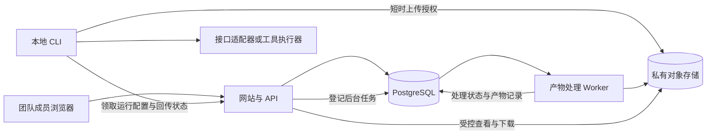

# 案例评测与结果回流平台方案评审与技术路线

评审日期为 2026 年 10 月 20 日。本文以 [PRD v2.1](/Users/a1234/WorkBuddy/测评网站/测评网站-PRD-v2.1.docx) 为需求依据，对照 [PRD v2](/Users/a1234/WorkBuddy/测评网站/测评网站-PRD-v2.docx) 中的历史技术设想，并阅读和操作了 [网站原型](/Users/a1234/WorkBuddy/测评网站/prototype/index.html)。这是供实施决策使用的建议稿，本文没有修改 PRD 或原型，也没有调用付费模型执行测试。

结论是产品方向合理，可以进入开发准备。批量运行、自动归档、并排查看和直接取用，能够对应内容团队的实际工作。开发前需要补齐运行协议、历史引用、素材检索和执行能力四类规则，并把基础取用能力提前放进首版。建议采用 TypeScript 单仓库，网站与 API 合并部署，本地 CLI 执行模型任务，独立后台进程处理产物，PostgreSQL 保存结构化记录，私有对象存储保存文件。

## 一 方案评审

### 应当保留的产品判断

- 面向团队内部的内容生产。首版围绕素材归档和使用展开，三档人工判定足够，不需要引入自动评分体系。
- 案例卡片呈现提示词和参考效果，多选后进入独立配置页，符合批量执行的工作方式。
- 一次对比以 2 至 3 个模型为主，运行矩阵和单案例并排详情可以保留。允许单模型运行，便于补跑和调试。
- 网站作为内部记录的权威来源，链接、复制和下载作为出口，单向输出足以满足首版需要。
- 执行保留在同事本机，能够复用现有工具链与登录环境。更准确的理由是工具环境在本机，并不要求模型权重也安装在本机。
- 案例版本和执行目录隔离从第一条真实运行起就要具备，后期迁移难以补回已经丢失的上下文。

### 开发前需要修正的产品规则

**1 发起运行需要经过等待本机接入这一阶段。** 浏览器创建了运行记录，不代表本地任务已经开始。首版操作应是创建运行、复制命令、本地执行器连接、执行前检查、开始任务。界面分别显示等待本机执行、执行中、上传中和可查看，避免用户以为关掉网页就能自动跑完。本机接入前保留本次配置和恢复入口。原型的“下拉并开始运行”应改为“创建运行并复制命令”。

**2 给写稿者的素材库还没有闭环。** 现在的结果页只有某一次运行的矩阵。写稿者通常想找某个模型、某个场景下过去可用的结果。保留三个主导航即可，在“运行结果”里提供“按运行查看”和“素材检索”两种视图。检索覆盖案例提示词、产物正文和人工备注，支持模型、场景、产物类型、判定和时间筛选。

**3 固定引用和最新结果需要分开。** PRD 一方面要求历史版本不变，另一方面说深链接指向最新状态。应明确历史运行的模型输出和文件不变，判定及备注可以追加修改记录。新一轮运行产生新地址。案例页可以提供最新可用结果入口，文章引用默认使用固定结果地址，避免重跑后稿件中的证据发生变化。

**4 调用方式由任务所需能力决定。** “文字走接口、文件走执行器”的规则过于绝对。一次接口响应里的 HTML、SVG 或脚本也能由 CLI 确定性地保存为文件。真正需要执行器的条件是要使用工具、运行命令、访问工作目录、迭代修改或渲染。同一案例版本固定 execution profile，包含工具链、执行预算与输出要求。比较模型时保持这一 profile 一致；工具链不同的结果显示为不同运行配置。

**5 案例必须包含输入素材与产物要求。** 原型中的 CSV 信息图和参考图还原案例都依赖提示词之外的输入。案例版本至少要包含提示词、输入附件及校验值、执行配置版本、预期产物类型与收集规则。参考效果独立标明“参考”，结果格子展示实际生成的产物，避免拿参考图当测试结果。

**6 模型参数按能力展示。** 各家接口和工具链对思考参数、温度范围、视觉输入及用量报告的支持存在差异，不能向所有模型一律发送相同字段。原型里的型号和参数都是待验证配置，不能视作账号已经支持的事实。发起页展示配置登记的能力；CLI 接入后核实本机安装、凭据与实际兼容性，不支持就明确阻止对应任务。

**7 未评审、待定与可用需要区分。** 未评审是还没有判定；待定是已经看过但尚不能确认。已判定还可能是不能用，不能将所有已判定结果统称为可信素材。素材检索默认展示可用结果，同时允许查看其他状态。执行失败独立于人工判定，不能自动等同于不能用。

**8 基础复制与下载进入首版。** 产品承诺是减少整理和搬运时间，等到 P2 才提供基础出口会推迟价值验证。首版就要有固定链接、复制正文、单文件下载和整批 ZIP。富文本表格与单图复制随后补齐；九宫格优先于完整的 GIF 多段编辑器。

### 范围与表达需要收敛的地方

三列是合理的默认阅读方式，但不能作为所有窗口下都可读的保证。桌面大屏保留并排，较窄窗口允许选择两列、横向查看或进入单条详情。运行矩阵中的缩略图服务于定位，正文和互动网页需要在详情里完整查看。

富文本粘贴效果受浏览器、权限与目标编辑器影响。网页支持 HTML 剪贴板格式，并不保证飞书一定保留所有表格与图片。PRD 中“剪贴板传不了文件，这是操作系统的边界”的表述也过于绝对，桌面系统存在文件引用格式。产品可以明确承诺“本网站的视频通过下载或链接取用”，避免承诺跨应用视频复制。依据为 [W3C 剪贴板标准](https://www.w3.org/TR/clipboard-apis/#mandatory-data-types-x) 与 [Microsoft 标准剪贴板格式](https://learn.microsoft.com/en-us/windows/win32/dataxchg/standard-clipboard-formats)。

“元信息完整”应定义为案例输入、执行配置、操作者、时间和产物归属完整；用量与成本允许未知，并记录原因和来源。工具订阅额度也不能伪装成精确的按 Token 账单。

旧版提出网页编辑自动写 Git 提 PR。对内容团队，建议首版以数据库中的不可变案例版本为准，支持 YAML 导入导出，把 Git 用于工程配置和备份。如果必须保留 Git 为权威源，就让网页修改经过提交与合并后再生效，并接受这一操作成本；不能让数据库与 Git 同时自由编辑同一案例。

对外只读分享、结果讨论和 @ 人可以后置。分享上线时必须具备单独的令牌、有效期和撤销能力，内部运行地址继续要求登录。内部成员全部可见这一简化规则可以保留。

### 原型核对结果

当前目录里只有单文件静态原型，没有应用服务、数据库模型或本地执行器工程。现阶段能够复用的是页面结构、视觉样式和交互意图，真实运行与数据管理需要另行实现。

| 观察项 | 已确认的现状 | 实施要求 |
| --- | --- | --- |
| 多选与发起页 | 8 个案例可全选，发起页显示 8 × 3 共 24 个任务 | 保留流程，配置保存到服务端 |
| 发起动作 | 按钮只显示提示、清空选择并跳转；结果仍是固定的 6 × 3 旧运行 | 创建真实 run_id，等本机接入后才显示执行中 |
| 单例超时 | 选择 10 分钟，命令仍显示 30m；配置没有绑定到运行数据 | 所有参数使用同一份经过校验的运行快照 |
| 结果归属 | 数据挂在 CASES.res，详情和矩阵复用参考效果；指标多处写死 | 每一个格子读取对应的结果与实际产物 |
| 记录保存 | 判定只改内存；备注没有保存逻辑 | 判定及备注写数据库，返回保存状态与修改记录 |
| 素材出口 | 仍有导出飞书按钮；导出、新建、GIF 生成只是提示 | 跟随 v2.1 改成实际可用的复制、下载与链接 |
| 筛选与导航 | 左侧筛选和搜索只更新案例库；结果页没有独立检索 | 切换页面时展示该页面适用的筛选条件 |
| 执行基础 | 没有真实上传、日志、失败状态、运行历史及固定详情路由 | 纳入首版数据与执行链路 |

证据位置包括 [发起与参数代码](/Users/a1234/WorkBuddy/测评网站/prototype/index.html:544)、[固定命令与运行矩阵](/Users/a1234/WorkBuddy/测评网站/prototype/index.html:640)、[详情和判定代码](/Users/a1234/WorkBuddy/测评网站/prototype/index.html:687)。本次进行了实际浏览器检查，并用源码确认了以上行为；没有验证真实模型调用或跨应用粘贴效果。

PRD 的不同载体也有漂移。v2.1 Word 增加了调用层级、协作、对外分享和九宫格等说明，对应 Markdown 草稿未全部同步；Word 第 3 节还残留“导出到飞书”的旧表述。建议后续维护一份需求正文，再生成 Word，实施时以明确标记的版本为准。

## 二 建议技术路线

### 结构与职责

网站负责定义、排期、记录和使用结果。本地 CLI 负责模型调用与工具执行。后台 Worker 只负责已上传产物的缩略图、视频衍生文件和导出包，不承担模型任务。

一个仓库内分为 `apps/web`、`apps/cli`、`apps/worker`，公共的任务定义、事件协议和校验放在 `packages/contracts`，适配器放在 `packages/adapters`。原型保留为设计参考，不在 859 行内联脚本上继续堆积业务。

### 技术选型

| 部分 | 建议选型 | 选择理由 |
| --- | --- | --- |
| 网站与 API | Next.js、React、TypeScript，Node.js LTS | 页面和 API 在同一应用内维护，前后端共用类型，部署边界少 |
| 交互与校验 | 复用现有视觉样式；Zod 校验公共协议 | 先保留已确认的界面，运行配置必须在服务端和 CLI 再校验 |
| 数据 | PostgreSQL、Drizzle、数据库迁移 | 版本、批次、结果和修改历史属于关系数据，事务与唯一约束更重要 |
| 文件 | 私有对象存储，通过独立存储模块接入 | 产物不放数据库；生产使用团队已有云存储，选型时实测其签名与分段上传能力 |
| 后台任务 | pg-boss、独立 Node.js Worker | 复用 PostgreSQL 处理重试任务，首版无需增加 Redis |
| 本地执行器 | Node.js LTS、TypeScript、命令行包 | 与服务端共享任务与事件定义，便于处理 HTTP 流和子进程 |
| 媒体处理 | FFmpeg、ffprobe；图片处理库；Playwright 截图 | 视频和网页处理从 HTTP 请求中移出，保持页面及时响应 |
| 登录 | Better Auth；优先复用已有 OIDC | 没有现成 SSO 时只开放受邀账号，使用成熟会话能力 |
| 状态更新 | 首版活动页每 2 至 3 秒拉取增量 | 对小团队先保证可恢复，后续需要流式日志时增加 SSE |
| 部署 | Docker Compose、HTTPS 反向代理 | 首版一套网站服务、一套 Worker、PostgreSQL 和对象存储即可 |

这些是结合项目规模作出的选型建议。Next.js 官方提供 [自托管方案](https://nextjs.org/docs/app/guides/self-hosting)；pg-boss 官方说明其使用 PostgreSQL 承担 [后台任务与重试](https://github.com/timgit/pg-boss)。Drizzle 的能力见 [官方文档](https://orm.drizzle.team/docs/overview)，登录能力见 [Better Auth](https://better-auth.com/docs/authentication/email-password) 与 [通用 OAuth 接入](https://better-auth.com/docs/plugins/generic-oauth)。具体依赖版本在初始化工程时锁定，不跟随 latest 自动漂移。

首版使用 Node 命令行包完成安装和更新，支持开发人员协助一次安装。默认优先验收 macOS，Linux 通过自动化检查；是否必须支持 Windows 需要在真实团队试用前确认。单文件可执行程序、签名安装器和托盘程序属于后续分发优化，不作为跑通业务的前置条件。

### 运行协议

命令建议改为 `casebench run <run_id>`，配置由 run_id 指向的不可变运行快照决定。原来的 `eval` 与 shell 内置命令重名，在当前 zsh 中已确认为 builtin，不适合作为工具入口。行为见 [zsh 官方说明](https://zsh.sourceforge.io/Doc/Release/Shell-Builtin-Commands.html#index-eval)。

一次运行按下列顺序推进。

1. 浏览器提交案例版本、模型配置和运行设置。服务端在事务中创建 Run、模型配置快照和 N × M 个 Result，返回 run_id，状态为等待本机执行。
2. 用户复制 `casebench run r_xxx`。CLI 通过已登录身份领取运行，服务端以租约和递增的领取代数防止同一运行被两台机器同时有效接管。
3. CLI 下载固定版本的案例和输入素材，校验哈希，检查工具安装、账号配置与参数兼容性。把可执行与不可执行的任务反馈给网页；默认不偷偷跳过配置错误，需要用户明确处理。
4. 每个 Result 的本次 Attempt 分配独立目录，路径为 `runs/<run_id>/<result_id>/<attempt_id>/`，输入与输出分目录。CLI 限制本机总并发，并针对厂商限流或独占资源另外约束。
5. 运行过程中持续写本地日志和检查点，按序号上传状态事件与心跳。日志、事件及状态提交都带 attempt_id 和租约代数。
6. 任务完成先落盘，再上传文件。服务端为确定的对象键发放短时授权，上传后核对大小与校验值，再将产物标记为可用。
7. 产物处理 Worker 生成缩略图等衍生物。执行成功、上传完成、预览可用分别记录，预览失败仍保留原文件下载入口。
8. 网页从数据库读取状态。浏览器关闭不会中止已启动的 CLI；本机休眠或 CLI 退出会中断本地执行，重新连接后按检查点恢复，不能承诺在机器离线时继续执行。

CLI 首版提供 `login`、`doctor`、`run`、`resume`、`sync`。`resume` 恢复未结束的任务，`sync` 专门补传已落盘的文件与记录，避免为上传失败重新花钱调用模型。平台登录令牌与模型厂商密钥分开，后者保留在本机环境或系统凭据库，服务端不接收模型密钥。

平台身份通过浏览器确认本机登录，CLI 持有可撤销的设备凭据，领取后换取该次运行范围的授权。服务端核实成员身份和运行归属，创建人从登录身份生成，不信任客户端自报。日志在上传前过滤密钥与授权头，网页会话继续检查来源与跨站请求，设备凭据不放进可分享链接或复制命令。

无需让本机监听公网端口，CLI 只主动向网站与对象存储发起 HTTPS 请求。`doctor` 由本机执行，网页无法在 CLI 尚未连接时直接获知当前电脑安装了什么。

### 适配器边界

先实现两类路径，再逐个验证具体厂商和具体工具链。

- 直接接口适配器处理一次请求或流式响应，保存正文及结构化用量；允许按固定规则把响应保存为 HTML、SVG 或其他文件。
- 工具执行适配器拉起团队实际常用的一种 harness，限定工作目录与工具权限，解析机器可读输出并收集文件。首先验证它能否为拟比较的模型保持相同工具链；不支持就限制该案例的可选模型，不伪装成一致比较。

对外契约包含能力探测、配置校验、可取消的执行事件流、产物清单和用量归一化。适配器状态按 Attempt 隔离。CLI 子进程使用程序名和参数数组启动，避免把提示词或用户输入拼进 shell 命令。Node 的相关能力见 [child_process 官方文档](https://nodejs.org/api/child_process.html#child_processspawncommand-args-options)。

execution profile 记录适配器版本、harness 版本、system prompt、工具清单、允许的网络与文件访问范围、最大轮次、停止条件和超时。案例编辑页面把这些复杂项收在执行模板里，内容同学选择经过验证的模板即可。

接口格式相近可以共用传输代码，但思考参数、用量语义、文件上传、限流和错误码继续由厂商转换层处理。首版优先验证文本和自包含网页，图片与视频先支持导入、归档及查看；需要生成图片或视频时再接对应工具模板。LLM 返回的视频脚本应归档为文本，不应展示为已生成的视频。

### 数据模型与历史语义

| 实体 | 核心内容 | 不变规则 |
| --- | --- | --- |
| Case | 稳定案例 ID、分类、当前版本指针 | 不删除仍被历史运行引用的案例 |
| CaseVersion | 提示词、附件及哈希、参考效果、执行模板与版本 | 发布后只新增版本，不就地修改 |
| Run | 创建人、案例版本集合、模型槽位、并发、超时和运行状态 | 发起时冻结配置，重跑创建新 Run |
| ModelConfig | 厂商、请求型号、能力定义、实际发送参数 | 一个比较列是配置槽位，同模型也可有不同配置 |
| Result | Run 内一个案例版本与一个模型配置槽位的交叉格 | 唯一键为 run_id、case_version_id、model_config_id |
| Attempt | 某格的一次执行，含执行器版本、响应型号、时间、用量与错误 | 重试新增 Attempt，旧日志与产物始终可追溯 |
| Artifact | 归属 Attempt、存储键、哈希、类型、尺寸、时长、处理状态 | 原始文件不覆盖；衍生物关联来源与处理参数 |
| Annotation 与 AuditEvent | 对具体 Attempt 的判定、备注、修改人、修改前后值与版本号 | 并发修改检查版本，保留历史；新 Attempt 不继承旧判定 |
| RunnerLease 与 RunEvent | 本机身份、租约、心跳、事件序号和领取代数 | 过期执行器不能继续提交有效状态 |
| ExportSnapshot | 选中的 Attempt、注释快照、文件哈希、导出时间 | 下载包可解释当时导出了哪些结果 |

关键字段包括 requested_model、reported_model、adapter_version、harness_version、profile_hash、case_content_hash、provider_request_id 和 CLI 版本。模型若只有浮动别名，记录版本精度为 alias 或 unknown，不能把“记录了名字”宣传成“完全可复现”。没有返回的服务端指纹不编造。

耗时拆成排队、执行、上传、处理和整体时间。模型 API 返回时延与整套工具任务时长分别展示，不混成同一个速度排名。用量保留输入、输出、缓存及来源；缺失为 null。成本记录币种、单价版本、计算方式和 reported、estimated、unknown 状态。订阅工具无法拿到真实单次账单时显示未知或估算，不写零。

### 状态与恢复

Run 对用户展示等待本机执行、执行中、整理中、完成、部分失败、失败和已取消。内部另外记录 runner_connected、last_heartbeat_at、lease_generation 与 connectivity；失联是连接状态，不能直接推断模型调用失败，更不能自动换机器再次调用。

每个 Attempt 分别保存执行状态、上传状态和衍生处理状态。人工判定独立保存，可为空，也可为可用、待定或不能用。结果已落盘但未上传时显示待补传，处理预览失败时显示原文件可下载。

平台网络重试通过 `(attempt_id, event_seq)` 等唯一键去重，产物登记按对象 ID 与哈希幂等提交。失败重试与用户主动重跑要分开，界面可以看到前一次尝试。

若上次调用可能已发给厂商，但本地还未记录响应，平台无法保证再次调用不会重复计费。优先用厂商请求标识查询或使用其支持的幂等机制；无法确认时显示需确认后重试。系统只能保证自己的记录去重，不能承诺外部执行天然恰好一次。

取消任务时停止领取新任务，终止当前适配器及其子进程组，保留已生成文件。远端请求若已经受理，取消也不保证取消计费，需要记录实际状态。

### 文件上传与预览

本地文件写入与平台可用性分开。CLI 有产物不代表另一台电脑已经能下载，只有服务端校验上传完成后才算归档。文件采用不可复用的对象键，至少包含 attempt_id 和 artifact_id，避免同名覆盖；大文件按所选存储的能力实现分段重试，本地未确认上传成功的文件不自动清理。S3 的 [限时上传授权](https://docs.aws.amazon.com/AmazonS3/latest/userguide/PresignedUrlUploadObject.html) 可作设计参考，其他云存储需要使用其实际兼容接口。

上传先落暂存对象，确认后固定归档版本。支持对象版本的存储把 version_id 一并写进产物记录；其他存储由服务端生成 CLI 无权覆盖的归档对象。历史下载引用固定的归档版本，不能因为旧上传授权尚未过期而被覆盖。

首版产物支持范围如下。

| 产物 | 首版方式 | 后续扩展 |
| --- | --- | --- |
| 文案 | 原文保存，安全渲染 Markdown，复制正文 | 选段、引用与全文检索优化 |
| 图片 | 原图、缩略图、PNG 复制、下载 | 批量拼图 |
| 静态网页 | 自包含 HTML 或明确入口的静态资源包，截图加隔离预览 | 需要开发服务器的应用单独设计执行与预览环境 |
| 视频 | 原文件下载、可播放预览、封面 | 九宫格、GIF 与片段编辑 |

收集文件必须限制在本次输出目录内，拒绝越界路径和指向外部的符号链接，限制数量与体积。解压网页资源包时同样防止路径逃逸。文件类型按实际内容校验，不能只信扩展名。

网页产物属于不可信代码。预览使用独立源，不携带主站登录 cookie，结合 iframe sandbox 与限制网络连接的 CSP，默认禁止顶层导航、弹窗、表单和访问内网。首版不向产物授予同源权限；需要 localStorage 等能力的案例先给截图与明确限制，后续以每产物独立源解决。有关边界见 [iframe 官方说明](https://developer.mozilla.org/en-US/docs/Web/HTML/Reference/Elements/iframe#sandbox)。

Worker 的协调进程读取队列，把截图与渲染放进单独的受限子容器，只传入需要处理的产物副本。子容器设置时间、内存和 CPU 限制，不挂载主站凭据，不允许访问数据库或内网，完成后由协调进程写回记录。独立域名保护浏览器侧，容器与网络限制保护服务器侧，两者都要做。本地独立目录只解决归属与覆盖问题，不等于安全沙箱；本机 harness 仍需使用其工作目录权限模式，避免默认赋予整机文件访问或任意命令权限。预览环境的功能限制要明确标注，不能当成模型产物本身的缺陷。

源文件是否删除需要按真实素材量决定，首版建议已被引用或标为可用的原始产物保留，ZIP 临时包设置较短有效期，未采用的大文件提供归档与清理入口。不要沿用旧版“原视频 90 天自动删除”的默认值，否则历史深链接可能只剩缩略图。数据库做定期备份，对象存储配置版本保护，并做一次恢复演练。

### 素材取用与协作

内部路由分工如下。

- `/r/<run_id>` 固定批次及其结果，运行参数和输出不被重跑替换。
- `/results/<result_id>/attempts/<attempt_id>` 固定一次具体执行，文章引用优先使用这一层。
- `/c/<case_id>` 展示案例及历史，可以有最新可用结果入口，并明确该入口随时间变化。
- 后续的 `/s/<token>` 展示获准分享的固定快照，具有期限与撤销能力。

判定与备注使用短时间防抖保存，展示保存中、已保存和失败重试。更新请求带版本号，两个人同时编辑时提示冲突并允许重新载入，不静默覆盖。首版用轮询同步这些更新即可，讨论与 @ 人后置。

文本类案例允许自动生成纯文字预览，不强制新建案例先上传效果图。案例卡片可以增加一个便于检索的短名称，但提示词原文继续作为主要信息，不增加必填负担。

复制整组输出 HTML 表格与纯文本两种表示，单图以 PNG 输出。操作由用户点击触发，在 HTTPS 顶层页面验证，失败时提供复制纯文本与下载。不能把内嵌预览面板里的权限失败当作所有浏览器都不支持。约束见 [Clipboard API 官方说明](https://developer.mozilla.org/en-US/docs/Web/API/Clipboard_API)。

ZIP 在 Worker 中流式生成，避免浏览器把大批视频全读入内存。包内含 `comparison.md`、`metrics.csv`、`manifest.json` 和按案例及模型配置划分的产物目录。清单锁定 Attempt 与哈希，包含失败和缺失项说明，文件名可读且加短 ID 防重名。CSV 对以公式字符开头的文本做安全处理，未知指标留空并给出原因。

九宫格由 FFmpeg 等距抽取最多九帧并通过 tile 合成，显示各帧时间点，保留比例，短视频不足帧时减少或合理补齐。GIF 采用调色板量化，按实测文件大小调整分辨率、帧率、颜色数或片段长度；不把原型的经验公式和固定 16 比 9 比例当作大小保证，也不把未核验的飞书 5 MB 限制写死为平台硬限制。工具能力见 [FFmpeg tile](https://ffmpeg.org/ffmpeg-filters.html#tile) 与 [调色板滤镜](https://ffmpeg.org/ffmpeg-filters.html#palettegen)。

对外分享默认不含成本、内部讨论、完整日志和环境信息；具体提示词、产物与备注由分享快照明确选择。存储桶保持私有，资产访问校验分享范围，短时下载授权的有效期不得长于分享期限。撤销必须影响后续资产访问，已签发链接的残余可用窗口要受短 TTL 限制。未实现这些边界前不开放外链。

### 搜索与性能

首版在 PostgreSQL 中按结构化字段筛选，对提示词、正文和备注做有长度限制的子串搜索。数据增多后通过 pg_trgm 增强索引，并用真实中文短词验证效果，不先承诺语义检索。该扩展支持 LIKE 与 ILIKE，短到无法提取 trigram 的模式可能退化扫描，见 [PostgreSQL 官方文档](https://www.postgresql.org/docs/current/pgtrgm.html)。

列表只加载分页元信息与缩略图，详情再加载完整产物。矩阵默认分页呈现，不把所有图片、视频和日志一次性传给前端。首版验收在团队真实网络、预定数据规模和 30 格以内矩阵上测量首屏，再决定是否增加虚拟滚动。

### 最小接口集合

| 接口职责 | 输入或返回 | 关键约束 |
| --- | --- | --- |
| 案例与版本 | 新建、检索、发布新版本 | 权限校验，版本不可变，附件哈希 |
| 创建运行 | 固定案例版本与模型配置，返回 run_id | 事务创建所有格子，客户端请求幂等键 |
| 领取与心跳 | runner_id、租约代数与本机能力 | 原子领取，过期接管有明确恢复规则 |
| 事件回传 | attempt_id、seq、状态与摘要 | 去重，校验状态转移，日志脱敏 |
| 产物上传与确认 | 清单、受限上传授权、校验结果 | 只可写指定对象，确认后才可下载 |
| 运行详情与素材检索 | 矩阵、Attempt 详情与筛选结果 | 内部登录，分页，增量游标 |
| 判定与备注 | 具体 Attempt、期望版本与修改内容 | 乐观并发，审计记录 |
| 导出 | 选定 Attempt 和输出类型 | 固定快照，后台任务，过期包可重建 |

## 三 实施顺序与验收

先做最小纵向链路，再扩展批量、协作和媒体。以下时间是两名熟悉 TypeScript 的工程师全职协作、已有部署资源时的初步日历估算，具体工具链与团队设备尚未盘点，应在验证后重估。

| 阶段 | 建议时间 | 交付与验收 |
| --- | --- | --- |
| 能力验证 | 2 至 3 个工作日 | 一条文本案例通过两家实际可用的模型接口；一条网页案例验证最常用 harness 是否能以相同配置跑目标模型；同时验证上传、PNG 复制与目标编辑器粘贴 |
| 最小闭环 | 约 1 周 | 网站创建 Run，本地 CLI 领取，一条结果落盘上传，另一台电脑能打开固定链接并下载；包含身份、版本与实际产物 |
| 团队可试用首版 | 再 2 至 3 周 | 批量矩阵、能力参数校验、失败恢复、判定备注、历史与基础检索、正文复制和 ZIP；成员可独立完成一次任务 |
| 取用与可靠性完善 | 再 1 至 2 周 | 富文本表格、PNG 复制、视频九宫格、备份恢复、分发优化；按真实需求加入外部只读分享 |
| 媒体编辑扩展 | 单独排期 | GIF 多段剪辑、复杂网页预览、更多工具适配器与讨论提醒 |

前四阶段约 5 至 7 个日历周，属于目前范围下的预算建议，并非承诺。PRD 中 8 至 9 人周可作为范围受控时的目标，但不能仅除以两人就认定 4 至 5 周必然完成：工具兼容验证、端到端联调和团队试用存在前后依赖。首版应明确排除完整 GIF 编辑器、复杂动态应用运行环境和自动 Git PR 流程。

验收优先证明以下几件事。

1. 从一个真实批次开始计时，跑完后无需手贴截图，另一台电脑能在一分钟内定位并取走已有可用产物。一分钟衡量人工整理与取用，不包含模型生成和大文件传输时间。
2. 创建运行后修改案例、执行模板或价格配置，旧运行仍能还原原输入、有效参数与当时成本口径。
3. 同一 run_id 在两台电脑同时执行，服务端只接受有效租约的提交，不能悄悄产生两套有效归档结果。
4. 本地断网、上传失败、进程中断后能够补传，已经落盘的成功产物不会因为恢复动作重新调用模型。
5. 同一案例重跑或重试不会覆盖旧文件、旧日志和旧判定；引用地址仍指向原来的 Attempt。
6. 两人同时改判定或备注可以发现冲突，重新登录后记录与修改历史仍存在。
7. 失败、超时、上传失败、未评审与待定在页面上可区分，未知 Token 和成本不显示为零。
8. 预览恶意 HTML 不能访问主站会话或内网，产物包不能用路径逃逸写入其他目录。
9. 在团队实际浏览器和编辑器里验证复制；剪贴板权限被拒绝时仍能使用纯文本或下载完成取用。

实现前需要盘点实际常用 harness、各厂商账号及可用模型、团队操作系统、现有登录和部署资源，以及真实输入输出样本。这些影响适配器与交付估算；不影响先确定以上运行协议与数据结构。

下一步最值得实施的是能力验证和最小闭环。用一条文本、一条网页、两家真实可用的模型把执行与归档跑通，通过后再扩展现有页面和批量能力。
